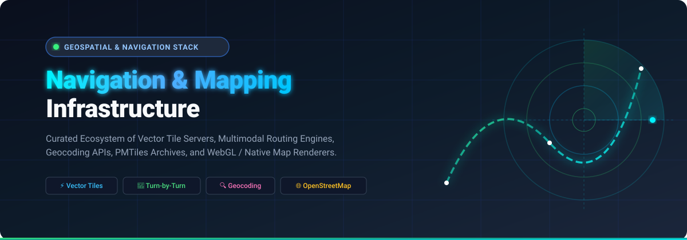

<p align="center">
  
</p>

# 🧭 Awesome Navigation &amp; Mapping Infrastructure 🗺️

<p align="center">
  <a href="https://github.com/ishandutta2007/Awesome-Awesome-Awesome"></a><a href="https://discord.gg/jc4xtF58Ve"></a>
  <a href="https://github.com/ishandutta2007/Awesome-Navigation-Mapping-Infrastructure/stargazers"></a>
  <a href="https://github.com/ishandutta2007/Awesome-Navigation-Mapping-Infrastructure/network/members"></a>
  <a href="https://github.com/ishandutta2007/Awesome-Navigation-Mapping-Infrastructure/issues"></a>
  <a href="https://github.com/ishandutta2007/Awesome-Navigation-Mapping-Infrastructure/blob/main/LICENSE"></a>
  <a href="https://github.com/ishandutta2007"></a>
</p>

> 🌟 A comprehensive, SEO-optimized curated directory of enterprise SaaS location platforms and self-hosted open-source software (FOSS) powering modern navigation, vector tile pipelines, turn-by-turn routing engines, forward/reverse geocoding APIs, and WebGL map rendering.
> 
> *Focused on Vector Tile Servers, Multimodal Routing Engines, Geocoding APIs, WebGL/Native Map Renderers &amp; OpenStreetMap Pipelines.*  
> **Last updated: November 2026**

---

## 📑 Table of Contents

- [🌐 Sector Overview &amp; Market Dynamics](#-sector-overview--market-dynamics)
- [☁️ SaaS / Hosted Platforms](#️-saas--hosted-platforms)
- [💻 Open-Source GitHub Projects](#-open-source-github-projects)
- [🛠️ Architecture &amp; System Integration Guide](#️-architecture--system-integration-guide)
- [🤝 How to Contribute](#-how-to-contribute)
- [☕ Support](#-support)
- [📈 Star History](#-star-history)
- [⚖️ Disclaimer](#️-disclaimer)

---

## 🌐 Sector Overview &amp; Market Dynamics

The global digital mapping and navigation infrastructure market is valued at approximately **$24B–$31B** and is projected to expand to nearly **$50B by 2030** at a compound annual growth rate (CAGR) of ~10%–11%, fueled by autonomous vehicle telemetry, ride-hailing networks, logistics optimization, and cloud GIS architectures. The sector exhibits a **moderately fragmented, bifurcated structure**: while consumer smartphone navigation and embedded automotive telematics remain concentrated among global hyperscalers and legacy cartography giants (Google Maps, HERE, TomTom), developer-first cloud platforms and enterprise analytics are actively fragmented and competed for by specialized SaaS players (Mapbox, CARTO, MapTiler) alongside an increasingly independent, self-hosted open-data ecosystem driven by OpenStreetMap (OSM), Overture Maps, and MapLibre.

---

## ☁️ SaaS / Hosted Platforms

Below is a detailed comparison of top commercial hosted mapping, routing, and geocoding providers. The table is ordered in descending order by enterprise scale (market capitalization, valuation, or estimated annual revenue footprint).

| Platform 🚀 | Description 📝 | Scale / Valuation / Revenue 📊 | Starting Tier Price 💳 | Free Tier / Trial Limit 🎁 |
| :--- | :--- | :--- | :--- | :--- |
| **[Google Maps Platform](https://google.com)** | Global mapping, Places POI search, 3D aerial tiles, and turn-by-turn routing APIs. | **~$2.1T Market Cap** (Parent: Alphabet Inc.; Maps estimated at $11B+ revenue) | Pay-as-you-go starting at $7.00 per 1,000 dynamic map loads / $5.00 per 1,000 routes | Free monthly SKU allowance: 10,000 free calls/mo for Essentials APIs (Dynamic Maps, Geocoding); 5,000 calls/mo for Pro SKUs |
| **[Mapbox](https://mapbox.com)** | Cloud location platform providing customizable vector maps, real-time traffic navigation SDKs, and Search APIs. | **$1.3B Valuation** (Series E; estimated $93M–$172M ARR) | Pay-as-you-go starting at $5.00 per 1,000 web map loads ($2.00/1k Directions, $5.00/1k Geocoding) | **50,000 map loads/month**, 100,000 Directions requests/month, 100,000 Geocoding requests/month, 100 Mobile Navigation MAUs free forever |
| **[HERE Technologies](https://here.com)** | Automotive and enterprise navigation cloud offering HD maps, fleet routing, and EV range optimization. | **~$1B Annual Revenue** (€4.4B+ enterprise order book; owned by Audi, BMW, Mercedes, Bosch consortium) | Pay-as-you-grow overages averaging ~$1.00 per 1,000 transactions; Pro Plan starting at **$449/month** | **250,000 free transactions/month** across core services (maps, routing, geocoding), 5,000 active SDK users, and 250 assets free forever (no credit card required) |
| **[TomTom Developer](https://tomtom.com)** | Commercial mapping, real-time traffic flow, EV routing, and search API platform built for mobility and logistics. | **~€550M Revenue / ~€450M Market Cap** (Euronext: TOM2) | Pay-As-You-Grow starting at $0.08 per 1,000 map tiles and $0.75 per 1,000 geocoding/routing requests | **50,000 map tile requests/day** (~1.5M/mo) and **2,500 non-tile requests/day** (75,000/mo search/routing) free forever (no credit card required) |
| **[CARTO](https://carto.com)** | Cloud-native spatial analytics and location intelligence connecting directly to Snowflake, BigQuery, Databricks, and PostGIS. | **~$300M–$375M Estimated Valuation** ($92M raised, ~$29M–$50M ARR) | Enterprise quote-based starting tiers; developer tile services starting at **$500/month** | **14-day to 30-day free trial** with full cloud spatial analytics access, unlimited queries, and connected data warehouse features (no upfront payment) |
| **[MapTiler Cloud](https://maptiler.com)** | Global cloud vector/raster map tile hosting, custom map styling studio, and 3D terrain elevation APIs for MapLibre. | **~$6M–$7.2M ARR** (Swiss-based, bootstrapped profitable enterprise; powers 500k+ devs) | Flex tier starts at **$30/month** (commercial license, 10 GB storage, high-DPI exports, overage metering) | **100,000 map requests/month**, 5 GB storage (1 file limit), vector/XYZ raster tiles free forever for non-commercial/testing use (no credit card required) |
| **[LocationIQ](https://locationiq.com)** | Cost-effective cloud geocoding, reverse geocoding, autocomplete, and static/vector map tile API powered by OSM. | **~$1.2M–$6M Annual Revenue** (Unwired Labs private filings; bootstrapped &amp; profitable) | Paid commercial plans start at **$49/month** (higher rate limits, commercial usage, private caching) | **5,000 requests/day** (~150,000 requests/month) at 2 req/sec rate limit free forever with required attribution link (no credit card required) |
| **[Jawg Maps](https://jawg.io)** | High-performance custom map hosting, vector tiles, elevation data, and routing for web and mobile apps. | **~$1M–$3M Estimated ARR** (European cloud mapping specialist based in Paris, France) | Commercial production plans start at **€250/month** (unlimited styling, dedicated support, commercial licensing) | **50,000 map views/month** free forever strictly for non-commercial projects, public open websites, and non-profits |
| **[OpenCage Geocoding](https://opencagedata.com)** | High-availability forward and reverse geocoding API aggregating OpenStreetMap, OpenAddresses, and GeoNames. | **~$250k–$500k ARR** (OpenCage GmbH; self-funded, profitable indie micro-multinational) | Tier X-Small starts at **€45/month** (10,000 requests/day, 15 req/sec rate limit, full commercial rights) | **2,500 requests/day** (~75,000 requests/month) at 1 req/sec rate limit free trial/developer account forever (no credit card required) |
| **[Stadia Maps](https://stadiamaps.com)** | Developer-focused hosted vector tiles, static maps, Valhalla-powered routing, and Pelias geocoding APIs. | **Seed / Indie Scale** (Developer-first geospatial infrastructure specialist) | Starter plan starts at **$20/month** (includes 1,000,000 credits/month and commercial production usage rights) | **200,000 credits/month** free forever for development, staging, evaluation, and academic non-commercial use (no credit card required) |

---

## 💻 Open-Source GitHub Projects

Curated list of production-grade open-source navigation engines, tile servers, renderers, geocoders, and spatial databases. **Sorted in descending order by GitHub stargazer count**. Every star badge links directly to the project's stargazers page.

| Project / Repository 📦 | GitHub Stars ⭐ | Category 🏷️ | Core Language 💻 | Description 📖 |
| :--- | :--- | :--- | :--- | :--- |
| **[Leaflet](https://github.com/Leaflet/Leaflet)** | [](https://github.com/Leaflet/Leaflet/stargazers) | Map Rendering SDK | JavaScript | The ubiquitous, mobile-friendly (~42 KB) open-source JavaScript library for interactive 2D web maps with an expansive plugin ecosystem. |
| **[Organic Maps](https://github.com/organicmaps/organicmaps)** | [](https://github.com/organicmaps/organicmaps/stargazers) | Mobile GPS App | C++ / Java / Swift | Privacy-first, offline navigation app for hikers, cyclists, and drivers powered by OpenStreetMap. Zero ads, zero tracking, zero bloat. |
| **[deck.gl](https://github.com/visgl/deck.gl)** | [](https://github.com/visgl/deck.gl/stargazers) | WebGL Data Vis | TypeScript / WebGL2 | High-performance WebGL2/WebGPU geospatial visualization framework for massive datasets, 3D animated trips, arcs, and H3 hexagonal layers. |
| **[OpenLayers](https://github.com/openlayers/openlayers)** | [](https://github.com/openlayers/openlayers/stargazers) | Map Rendering SDK | JavaScript | Enterprise-grade dynamic web map library supporting complex GIS projections (CRS), WMS/WMTS, OGC standards, and vector tiles. |
| **[Mapbox GL JS](https://github.com/mapbox/mapbox-gl-js)** | [](https://github.com/mapbox/mapbox-gl-js/stargazers) | Map Rendering SDK | TypeScript / GL | Flagship WebGL interactive vector tile map renderer (v1 open-source / v2+ metered commercial SDK). |
| **[MapLibre GL JS](https://github.com/maplibre/maplibre-gl-js)** | [](https://github.com/maplibre/maplibre-gl-js/stargazers) | Map Rendering SDK | TypeScript / WebGL | Community-governed 100% free and open-source WebGL vector map renderer forked from Mapbox GL JS with modern 3D terrain and globe views. |
| **[MapSCII](https://github.com/rastapasta/mapscii)** | [](https://github.com/rastapasta/mapscii/stargazers) | Terminal Renderer | JavaScript | Braille &amp; ASCII world map renderer for terminals and SSH consoles powered by OpenStreetMap vector tiles. |
| **[Open Source Routing Machine (OSRM)](https://github.com/Project-OSRM/osrm-backend)** | [](https://github.com/Project-OSRM/osrm-backend/stargazers) | Routing Engine | C++ | Blazing-fast continental-scale routing engine utilizing Contraction Hierarchies (CH) and Multi-Level Dijkstra (MLD) for sub-millisecond queries. |
| **[GraphHopper](https://github.com/graphhopper/graphhopper)** | [](https://github.com/graphhopper/graphhopper/stargazers) | Routing Engine | Java | Memory-efficient routing engine and server supporting turn-by-turn road navigation, custom vehicle profiles, and vehicle routing optimization (VRP). |
| **[Uber H3](https://github.com/uber/h3)** | [](https://github.com/uber/h3/stargazers) | Spatial Indexing | C | Open-source hexagonal hierarchical spatial index that partitions the globe into uniform hexagonal cells for spatial aggregation and analytics. |
| **[OpenFreeMap](https://github.com/hyperknot/openfreemap)** | [](https://github.com/hyperknot/openfreemap/stargazers) | Free Tile Host / Server | Go / TypeScript | Turnkey, completely free, and open-source vector map hosting platform serving global OpenStreetMap tiles for websites and apps. |
| **[Valhalla](https://github.com/valhalla/valhalla)** | [](https://github.com/valhalla/valhalla/stargazers) | Routing Engine | C++ | Multimodal open-source routing engine supporting car, truck, bicycle, pedestrian, public transit, live traffic, isochrones, and map matching. |
| **[OsmAnd](https://github.com/osmandapp/OsmAnd)** | [](https://github.com/osmandapp/OsmAnd/stargazers) | Mobile GPS App | Java / C++ | Feature-packed offline mobile GPS navigation and map application for Android and iOS using global OpenStreetMap data. |
| **[Nominatim](https://github.com/osm-search/Nominatim)** | [](https://github.com/osm-search/Nominatim/stargazers) | Geocoding Engine | Python / C++ | Official open-source OpenStreetMap forward and reverse geocoding engine backed by PostgreSQL and PostGIS. |
| **[Mapbox GL Native](https://github.com/mapbox/mapbox-gl-native)** | [](https://github.com/mapbox/mapbox-gl-native/stargazers) | Native Map SDK | C++ / Objective-C | Native client-side vector tile rendering engine for iOS, Android, macOS, and embedded automotive infotainment systems. |
| **[Martin Tile Server](https://github.com/maplibre/martin)** | [](https://github.com/maplibre/martin/stargazers) | Tile Server | Rust | Ultra-fast vector tile server written in Rust capable of serving Mapbox Vector Tiles (MVT) on the fly from PostGIS, MBTiles, and PMTiles. |
| **[Pelias Geocoder](https://github.com/pelias/pelias)** | [](https://github.com/pelias/pelias/stargazers) | Geocoding Engine | Node.js | Modular, open-source geocoder powered by Elasticsearch aggregating OpenStreetMap, OpenAddresses, GeoNames, and Who's On First. |
| **[Protomaps PMTiles](https://github.com/protomaps/PMTiles)** | [](https://github.com/protomaps/PMTiles/stargazers) | Tile Storage Spec | TypeScript / Go | Cloud-native, single-file pyramid archive format enabling serverless hosting of planet-scale vector tiles directly on AWS S3/Cloudflare R2 via HTTP range requests. |
| **[OpenMapTiles](https://github.com/openmaptiles/openmaptiles)** | [](https://github.com/openmaptiles/openmaptiles/stargazers) | Vector Tile Schema | SQL / Shell | Open standard vector tile schema and compilation pipeline for street, terrain, and satellite basemaps from OpenStreetMap data. |
| **[Photon](https://github.com/komoot/photon)** | [](https://github.com/komoot/photon/stargazers) | Geocoding Engine | Java | Fast, typo-tolerant search-as-you-type autocomplete geocoder built on Elasticsearch and powered by Nominatim OpenStreetMap data. |
| **[Tippecanoe (Felt / Mapbox)](https://github.com/mapbox/tippecanoe)** | [](https://github.com/mapbox/tippecanoe/stargazers) | Tile Generator | C++ | Industry-standard command line utility to build vector tilesets from large collections of GeoJSON and spatial features across any zoom level. |
| **[TileServer GL](https://github.com/maptiler/tileserver-gl)** | [](https://github.com/maptiler/tileserver-gl/stargazers) | Tile Server | JavaScript | Popular vector and raster map tile server rendering server-side static PNGs and serving GL styles from MBTiles and PMTiles sources. |
| **[OpenTripPlanner](https://github.com/opentripplanner/OpenTripPlanner)** | [](https://github.com/opentripplanner/OpenTripPlanner/stargazers) | Transit Planner | Java | Complete multimodal trip planner combining OpenStreetMap pedestrian/cycling networks with public transit schedules in GTFS and GTFS-Realtime formats. |
| **[Maputnik Style Editor](https://github.com/maplibre/maputnik)** | [](https://github.com/maplibre/maputnik/stargazers) | Map Design GUI | TypeScript | Open-source visual style editor for the MapLibre/Mapbox GL style specification for designing interactive custom basemaps. |
| **[MapLibre Native](https://github.com/maplibre/maplibre-native)** | [](https://github.com/maplibre/maplibre-native/stargazers) | Native Map SDK | C++ / Metal / Vulkan | Cross-platform GPU-accelerated map rendering SDK for Android, iOS, macOS, and Linux powered by Metal and Vulkan. |
| **[PostGIS](https://github.com/postgis/postgis)** | [](https://github.com/postgis/postgis/stargazers) | Spatial Database | C | Foundational spatial database extender for PostgreSQL providing spatial SQL indexing, polygons, geometry operations, and live `ST_AsMVT` tile rendering. |
| **[Planetiler](https://github.com/onthegomap/planetiler)** | [](https://github.com/onthegomap/planetiler/stargazers) | Tile Generator | Java | High-speed compiler capable of converting the entire OpenStreetMap planet into PMTiles or MBTiles vector tiles in under one hour on a single machine. |
| **[VROOM](https://github.com/VROOM-Project/vroom)** | [](https://github.com/VROOM-Project/vroom/stargazers) | Route Optimization | C++ | Vehicle Routing Open-source Optimization Machine for solving complex VRP, TSP, and fleet dispatch problems atop OSRM and Valhalla routing matrices. |
| **[osm2pgsql](https://github.com/osm2pgsql-dev/osm2pgsql)** | [](https://github.com/osm2pgsql-dev/osm2pgsql/stargazers) | Data Ingestion | C++ | Essential command line tool for importing and incrementally synchronizing OpenStreetMap data into PostgreSQL/PostGIS databases. |
| **[pgRouting](https://github.com/pgRouting/pgrouting)** | [](https://github.com/pgRouting/pgrouting/stargazers) | SQL Routing | C / C++ | PostgreSQL/PostGIS extension that adds geospatial graph routing functionality (Dijkstra, A*, Driving Distance, TSP) directly in SQL queries. |
| **[Overpass API](https://github.com/drolbr/Overpass-API)** | [](https://github.com/drolbr/Overpass-API/stargazers) | OSM Query API | C++ | High-throughput database engine optimized for querying selected subsets of OpenStreetMap data using custom Overpass QL syntax. |
| **[Ferrostar](https://github.com/stadiamaps/ferrostar)** | [](https://github.com/stadiamaps/ferrostar/stargazers) | Turn-by-Turn SDK | Rust / Swift / Kotlin | Modern, cross-platform open-source turn-by-turn navigation core written in Rust for native iOS, Android, and Web applications. |
| **[Overture Maps CLI](https://github.com/OvertureMaps/overturemaps-py)** | [](https://github.com/OvertureMaps/overturemaps-py/stargazers) | Data Pipeline | Python | Official Python CLI for downloading and querying Overture Maps Foundation open global basemap datasets (buildings, places, transportation) in GeoParquet. |
| **[DemoTiles](https://github.com/maplibre/demotiles)** | [](https://github.com/maplibre/demotiles/stargazers) | Demo Vector Tiles | HTML / JSON | Serverless demo vector tiles and basemap style hosted directly on GitHub Pages for CI testing, rapid prototyping, and hello-world experiments. |

---

## 🛠️ Architecture &amp; System Integration Guide

Modern mapping and navigation stacks can be entirely assembled using sovereign, self-hosted open-source components with zero per-request licensing fees:

```
  [ Client Application: Web, iOS, Android, Terminal ]
                           │
         ┌─────────────────┼─────────────────┐
         ▼                 ▼                 ▼
   Map Rendering     Routing / Nav       Geocoding
  MapLibre GL JS      Valhalla / OSRM     Photon /
  MapLibre Native       GraphHopper       Nominatim
  Leaflet / deck.gl      Ferrostar         Pelias
         │                 │                 │
         ▼                 ▼                 ▼
  [ Vector Tiles ]    [ Graph Data ]   [ Spatial Index ]
   Martin / PMTiles    OSM PBF Graph     PostGIS / H3 /
    TileServer GL                         Elasticsearch
         │                 │                 │
         └─────────────────┼─────────────────┘
                           ▼
          [ Global Raw Data Foundation ]
          OpenStreetMap (OSM) / Overture Maps
```

1. **Tile Generation &amp; Hosting**: Use **Planetiler** to generate a single-file `planet.pmtiles` archive from OpenStreetMap, and host it serverlessly on **Cloudflare R2** or serve live via **Martin** / **TileServer GL**.
2. **Turn-by-Turn Navigation**: Deploy **Valhalla** or **OSRM** for real-time shortest-path routing, isochrones, and matrix calculations; pair with **Ferrostar** for client-side navigation UI.
3. **Address Search**: Deploy **Photon** or **Pelias** for fast search-as-you-type autocomplete and address resolution.
4. **Front-End Visualization**: Render high-framerate vector maps with **MapLibre GL JS** (web) or **MapLibre Native** (mobile/embedded) styled with **Maputnik**.

---

## 🤝 How to Contribute

Contributions are always welcome! Help keep this mapping and navigation directory up to date:

1. 🍴 Fork the repository.
2. 🌿 Create a new feature branch (`git checkout -b feature/add-new-project`).
3. 📝 Add your entry to the appropriate table or section following the existing markdown style and column structure.
4. 🔗 Ensure all URLs, GitHub links, and star badges are accurate.
5. 🚀 Submit a Pull Request with a clear summary of your additions.

---

## ☕ Support

If you find this curated navigation and mapping infrastructure guide helpful, consider supporting the maintenance of this and other open-source knowledge bases:

- ⭐ **Star** this repository to increase visibility for open geospatial builders!
- 🍴 **Fork** and share with your teammates, GIS architects, and developer friends.
- 💖 **Sponsor**: Buy me a coffee or support ongoing maintenance on the [GitHub Sponsor Dashboard](https://github.com/sponsors/ishandutta2007).

---

## 📈 Star History

[](https://star-history.com/#ishandutta2007/Awesome-Navigation-Mapping-Infrastructure&Date)

---

## ⚖️ Disclaimer

- This is a community-curated, factual technical directory — inclusion does not represent an endorsement.
- All brand names, product titles, and trademarks are the property of their respective owners.
- When deploying mapping software powered by OpenStreetMap or Overture Maps data, verify compliance with the Open Database License (ODbL) and provide proper attribution (`© OpenStreetMap contributors`).
